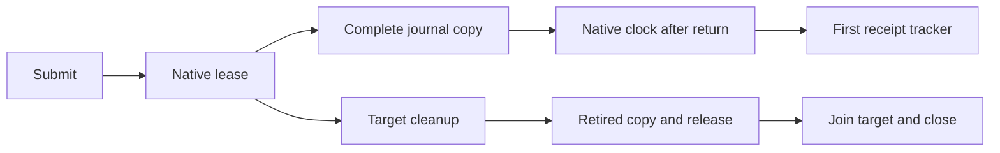

# Target-local timer ABI

`native/service/TimerApi.h` defines the portable `CozNet.Timer` C ABI.
`TimerApi.Linux.cpp` implements Linux x64 delivery through `TargetLease` and `LeaseMailbox`.
Managed declarations and receipt handling live in `tests/CozNet.LinuxPerf/NativeTimerClient.cs`.
The backend remains a prototype. Public engine support is unchanged.

```powershell
dotnet run --project build/build.fsproj -- -t LinuxTimerApi
dotnet run --project build/build.fsproj -- -t TimerLayoutVerify
dotnet run --project build/build.fsproj -- -t LinuxTimerInterop
```

The session permits one controller and up to 64 registered targets.
Each target owns registration and retirement. The controller owns submit, cancel, snapshot, release, clock, and close.
One process can open only one session, including after close.
The backend reserves `SIGRTMIN + 7` with a prior default disposition.
`coz_timer_configure_initial_interval` accepts 10,000 or 1,000,000 ns before any target has registered.
The default remains 1,000,000 ns. Registration permanently seals the interval for that session.
The managed boundary consumes a parsed `TimerInitialInterval`. Unsupported text never reaches native configuration.

The child ABI size is 72 bytes, with `valid` at offset 64.
The snapshot size is 96 bytes, with `backend_error` at offset 88.
Statuses are positive Linux errno values. `ENOBUFS` returns a header without child copying or release authorization.
The insufficient-buffer header includes a nonzero capture timestamp taken after the core snapshot.
This lets controller probes compare unchanged headers without treating an absent timestamp as clock regression.
Release requires a complete retired snapshot with no possible delivery.
`captureTimerJournal` also requires the mailbox reader to observe quiescence before exposing retired visibility.
Core retirement published before mailbox quiescence remains visible as quiesced, so a full copy cannot authorize early reuse.
The portable snapshot checks hold that exact intermediate state and reject generation-mismatched readers.

The signal handler acquires the announced generation before reading timer registration metadata.
Generation zero returns before those metadata reads.
An execution token spans continuation arms. Rejected initial arms retain ownership until target cleanup.
Final target cleanup blocks delivery, deletes the timer, drains, and resolves execution or recovery ownership.
Cleanup failures retain registration state. Close rejects registration or outstanding results.
The handler count protects session storage during close.



The managed client reads the same native clock immediately after copy return.
The first receipt bound is immutable. Late receipts and failed clocks permanently poison the tracker.
Raw captures survive rejection. Cleanup release does not accept rejected receipt evidence.
The managed handle finalizer deliberately retains unresolved ownership.

The native fixture checks two targets and four commands in deferred and chained-wait modes.
Before its final submission, the target blocks timer delivery and acknowledges the mask to the controller.
The zero-child retirement assertion therefore does not rely on target scheduling within the initial 1 ms interval.
The managed fixture uses an ineligible range and performs no wait.
Its modes preserve a timely first receipt, reject a 150 ms delayed first copy, and reject actual wrong-thread clock `EPERM`.
Later valid clocks cannot repair either rejection.
The outer watchdog bounds targets that park after failed retirement.
The runner retains its readiness event after a join timeout and joins only successfully started threads.
The [timer accounting adapter](timer-accounting.md) consumes accepted receipts and retains failed reservations.
The [managed payment workload](timer-managed.md) checks actual paid journals during controlled arithmetic.
The managed payment workload checks forced collection reach inside controller command intervals.
General CLR safety, sampled capacity, and physical prediction remain incomplete.

See [the human reference](../../docsSrc/Reference/timer-interop.md), [verification procedure](../../docsSrc/How_Tos/verify-timer-interop.md),
[portable ownership](target-local-lease.md), and [the index](../lode-map.md).
