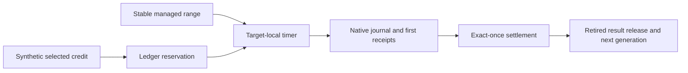

# Managed timer payment workload

`TimerManagedWorkload` accepts a parsed initial timer interval without changing its scenario plan.
`LinuxFastTimerTransitions` selects 10 µs for the same eight scenarios and retains the interval in each record and the manifest.
The [short-interval matrix](../../reliability/features/native-signal/timer-fast-transitions.md) passes all eight cases with unchanged bounds.
Transition cases record 56 selected payments without GC and 57 with GC. Every forced-GC case reaches a complete collection inside a command.

`TimerManagedWorkload` connects the timer C ABI and accounting adapter to the selected `CpuWorkload.Run` native code range.
It requires Linux x64, disabled tiering and ReadyToRun, no startup profiler, and a unique optimized perf-map entry.
The workload preserves the exact initial and final perf-map bytes and requires the selected range to remain unchanged.

```powershell
dotnet run --project build/build.fsproj -- -t LinuxTimerManaged
```

Two target registrations run the arithmetic method and check every result against 49,995,000.
The selected target pays overshoot debt. The peer target runs the chosen scenario.
The controller uses one selected ledger thread and one peer ledger thread across 16 fixed synthetic-credit steps.
Each step publishes 110,000 ns of credit. Existing overshoot can eliminate a new lease, which is recorded as a skipped step.
Otherwise the controller submits the reserved debt, consumes immutable prefixes, settles once, and releases the retired result.
Success requires reused generations and at least one completed lease with multiple paid children.
Progress counters must increase between controller observations before submission and after final receipt processing.
These brackets include controller overhead and do not prove progress within the native lease or between individual handlers.



The runner uses the existing timer script with `-ManagedWorkload` and retains unique `artifacts/timer-managed/` directories.
It records source, binary, and container identities and uses a 20-second outer watchdog.
Requested child wait stays at most 50,000 ns, handler interval at most 5 ms, first receipt at most 100 ms, and lease budget at most 2 ms.
Raw snapshots survive accounting failure. Failed retirement keeps the target alive and prevents close.
The [retained run](../../reliability/features/native-signal/timer-managed.md) passes with 15 reused generations and 42 paid children.
Independent debt arithmetic explains its skipped credit step through preserved overshoot.
The transition matrix extends this harness through `TimerWorkloadPlan` and `ISignalTransitionOperations`.
Its four scenarios use 128 steps with 5,000 ns of selected credit per step and run with and without GC.
JIT and wait scenarios require deferred journals with zero wait.
The transition scenario requires both paid selected code and an interrupted native fixture address.
The runner retains every outcome under `artifacts/timer-transitions/`.
See [the transition reference](../../docsSrc/Reference/timer-transitions.md) for reach and cleanup contracts.
General CLR safety, sampled capacity, and prediction accuracy remain unverified.
The [retained transition matrix](../../reliability/features/native-signal/timer-transitions.md) passes seven cases.
Its forced-GC transition case fails when peer overshoot exceeds the next synthetic selected credit.
The retained failure came from a harness that rejected selected-side payment.
`TimerSelectedWorker` now owns a second arithmetic target and pays selected debt through bounded timer leases.
Its journals and unfinished snapshots remain separate from peer records.
Both targets must join before native close. Failed retirement retains ownership.
`TimerWorkerLifetime` owns the selected worker's portable lifecycle decisions.
Release requires both `Retired` and `Joined`. A failed release leaves `Released` false and prohibits session close.
Worker and retirement errors remain available together instead of replacing the original failure.
After release succeeds, repeated cleanup skips all effects but still reports a prior worker failure.
Nine callback-driven checks cover ordering and failure outcomes without native calls or leaked background threads.
Isolated mutations detect missing retirement and join gates, premature release confirmation, lost primary errors, and repeated cleanup effects.
The [lifecycle matrix](../../reliability/features/native-signal/timer-worker-lifetime.md) passes all eight live scenarios with confirmed selected retirement.
Native syscall fault injection and exhaustive runtime races remain outside their scope.
See [the lifecycle reference](../../docsSrc/Reference/timer-worker-lifetime.md).
Each synthetic-credit step establishes the current epoch baseline before adding its CPU increment.
After each completed peer lease, peer catch-up publishes overshoot and selected service pays it before the next credit step.
Paid scenarios require a positive selected payment, so an unused recovery path cannot satisfy the live gate.
The revised matrix passes all eight cases, including 52 selected payments without GC and 68 with GC in the transition scenarios.
Arithmetic regressions pass with 16 selected payments in each mode.
The separate selected worker changes CPU demand. These runs do not provide a controlled timing comparison with the single-target fixture.

`LinuxTimerManagedGc` selects the same workload with `gc` mode.
It starts the existing `SampledGcStress` worker and releases it only after the first accepted native submission.
Each command records a Stopwatch interval from submission return to final receipt processing.
`TimerGcReach` requires one complete positive-index collection inside one recorded command interval.
Collections spanning commands or occurring between them do not establish reach.
All collection calls retain the existing 250 ms bound.
The GC worker must join before its observations are read. A failed join retains unavailable-observation status and fails the run.
Unfinished timer intervals and raw snapshots remain available on failure.
This reach check does not prove overlap with an individual native wait or a runtime suspension.
Portable checks cover parsing, exact boundaries, invalid intervals, outside collections, and the shared GC lifetime and duration rules.
The [retained GC run](../../reliability/features/native-signal/timer-managed-gc.md) passes with 16 generations and three collection calls.
Two complete calls fit inside command intervals. The largest call is 3.776224 ms.
Fourteen leases complete with multiple paid children. Two defer and preserve their unpaid debt.
The no-GC regression run also passes. General CLR safety remains unverified.

See [timer accounting](timer-accounting.md), [interop](timer-interop.md), and [the index](../lode-map.md).
