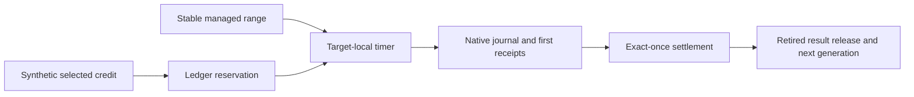

# Managed timer payment workload

`TimerManagedWorkload` connects the timer C ABI and accounting adapter to the selected `CpuWorkload.Run` native code range.
It requires Linux x64, disabled tiering and ReadyToRun, no startup profiler, and a unique optimized perf-map entry.
The workload preserves the exact initial and final perf-map bytes and requires the selected range to remain unchanged.

```powershell
dotnet run --project build/build.fsproj -- -t LinuxTimerManaged
```

One target registration runs the arithmetic method and checks every result against 49,995,000.
The controller uses one selected ledger thread and one peer ledger thread across 16 fixed synthetic-credit steps.
Each step publishes 110,000 ns of credit. Existing overshoot can eliminate a new lease, which is recorded as a skipped step.
Otherwise the controller submits the reserved debt, consumes immutable prefixes, settles once, and releases the retired result.
Success requires reused generations and at least one completed lease with multiple paid children.
Progress counters must increase between controller observations before submission and after final receipt processing.
These brackets include controller overhead and do not prove progress within the native lease or between individual handlers.



The runner uses the existing timer script with `-ManagedWorkload` and retains unique `artifacts/timer-managed/` directories.
It records source, binary, and container identities and uses a 20-second outer watchdog.
Requested child wait stays at most 50,000 ns, handler interval at most 5 ms, first receipt at most 100 ms, and lease budget at most 2 ms.
Raw snapshots survive accounting failure. Failed retirement keeps the target alive and prevents close.
The [retained run](../../reliability/features/native-signal/timer-managed.md) passes with 15 reused generations and 42 paid children.
Independent debt arithmetic explains its skipped credit step through preserved overshoot.
Forced GC, runtime transitions, sampled capacity, and prediction accuracy remain unverified.

See [timer accounting](timer-accounting.md), [interop](timer-interop.md), and [the index](../lode-map.md).
