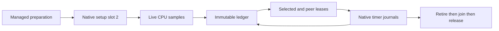

# Sampled timer execution

`SampledTimerWorkload` connects real `ICpuEventSession` observations to `TimerServiceController` for two synchronous arithmetic workers.
Linux x64 supplies the native timer, thread CPU clock, and perf adapters. The public engine remains serial and synchronous.
The controller alone owns immutable accounting. Each registered native target retains its own ledger thread and generation sequence.

```powershell
dotnet run --project build/build.fsproj -- -t LinuxFastTimerCapacity
dotnet run --project build/build.fsproj -- -t LinuxFastTimerGc
```

Selected service reservations advance the eligibility epoch and disable sampling before native submission.
Queued samples are excluded. Sampling resumes only after retired release. The next epoch's first sample earns no credit.
Observed debt subtracts active confirmed waits for both workers, in addition to committed waits and selected credit.
Scalar debt checks run every iteration. Boundary snapshots are allocated for periodic capture, new peaks, and failures.
The 2 ms observed debt bound, 2 ms lease budget, 50 µs requested wait, 5 ms handler bound, and 100 ms receipt bound remain fixed.

Managed initialization runs the actual drain, prepare, and poll closures with a synthetic perf record and timer transport.
It requires 40,000 ns credit, 70,000 ns peer wait, 30,000 ns selected wait, zero debt, and no pending ownership.
Live measurement receives fresh accounting, sample stream, counters, and cadence. Synthetic records remain separate under `initialization`.
Native setup uses dedicated slot 2 before live workers register in slots 0 and 1.
It requires one deferred 50,000 ns command with zero wait, then retires, joins, and releases its target.
The native API permits only one session per process. Setup must not close and reopen it.



Timer diagnostics retain the latest 128 eligible phase records and report overwritten records.
The first drain, sample-bearing drains, submissions, changed journal reads, and failures are eligible.
Probe and lease-preparation costs remain outside service phases. Other workloads keep prefix capture.
`LinuxFastTimerCapacity` disables these continuous diagnostic clocks and allocations.
Both modes retain samples, journals, boundaries, and failure evidence.

The workload's outer error list retains exceptions until cleanup completes, then formats their text.
Controller journals format their failures immediately.
The controller retains operation and closing-clock failures together in an `AggregateException`.
A closing-clock failure produces no phase interval. The workload still fails, and later phases can start.
`ReleasedWait(slot)` records cumulative confirmed wait after native release and before diagnostic phase closure.
Debt checks and output use this total even when phase closure fails. The archived journal retains that failure without another native release.
After workers release ownership, `TimerSessionCleanup` retains sample-disposal, native-close, and gate-disposal errors independently.
Each operation still runs after an earlier error. `closed` describes native close, while any error keeps the run failed.
A diagnostic exception during the shutdown release callback can leave the lifetime unreleased after native release and prevent session cleanup.
This conservative prototype limit retains the failed callback as a failed cleanup contract. Wait totals remain available.
It polls pending journals before cancellation, retires and joins workers, and requires retired release before native close.
Remaining ledger debt is recorded, not forgiven. Ambiguous submission or release retains ownership.
Native retirement visibility requires both core retirement and mailbox quiescence. Portable checks hold the publication gap explicitly.

`LinuxFastTimerGc` starts the real GC worker at measurement release.
It requires a complete collection inside the measurement window, a joined worker, and every collection call within 250 ms.
It requests GC stop before native cleanup and reads GC observations only after join.
This reach condition does not establish overlap with a particular native wait.

The [capacity evidence](../../reliability/features/native-signal/timer-sampled.md) contains one passing phase-free 10 µs run with 2,360 treatment journals.
The [transition evidence](../../reliability/features/native-signal/timer-fast-transitions.md) covers eight controlled runtime cases with and without GC.
The latest sampled forced-GC run fails at 2,499,975 ns peer debt while completing native cleanup and GC reach.
Its pending peer command has a 9,791,273 ns arm-to-first-handler interval and no overlapping recorded forced collection call.
Four regularly spaced sample receipts precede the first debt violation while that command remains unpaid.
The evidence narrows the next diagnostic to target scheduling and native delivery before the first handler clock reading.
It does not distinguish those causes or exclude unrecorded runtime suspension. Use scheduler capture without relaxing the debt gate.
Repeatability, sampled forced-GC capacity, general CLR safety, and physical prediction accuracy remain unverified.

`LinuxFastTimerScheduler` adds scheduler capture to prepared forced-GC capacity mode through `ISchedulerEventSession`.
Capture indices are controller, selected target, and peer target. `LinuxSchedulerEventSession` is the current backend.
Each target creates its capture on its own thread. A registration gate prevents late capture creation during shutdown.
Shutdown finishes and disposes every scheduler session before it permits native target retirement.
An unresolved scheduler disposal keeps targets alive and prevents native close. Capture errors and loss fail the workload.
`schedulerCaptures` retains the raw records and enable/disable brackets. `schedulerStopped` records the shutdown gate.
This optional mode adds collector threads and allocations. It does not establish ordinary-mode capacity or observer cost.
The first loss-free capture retains a startup debt failure with 2,349,871 ns of peer preemption overlap in a 2,353,895 ns arm-to-handler interval.
Controller and selected switch-out overlap are zero for that interval. This establishes descheduling in that run, not its underlying cause.
`TimerSchedulerCaptureGroup` owns registration, completion evidence, and the retirement gate.
Its portable checks cover disabled capture, normal ordering, failed disposal, failed capture, loss, duplicate registration, and partial startup.
The failed-disposal check uses `TimerWorkerLifetime` to verify retained ownership and blocked retirement.
Repeated completion returns retained evidence without retrying an ambiguous disposal. Observer-cost measurements remain outstanding.

`LinuxTimerSchedulerCost` runs eight paired zero-percent cases with scheduler capture enabled or disabled and forced GC in both modes.
The runner randomizes each pair's order with seed 20261014 and retains all outcomes. It does not retry failed cases.
Both workers start at zero progress. `measurementProgress` records each worker's completed checksum batches before shutdown.
`progressCapturedBeforeTimestamp` and `progressCapturedAfterTimestamp` bracket the two counter reads.
Use those brackets with `measurementStartedTimestamp` and `timestampFrequency` to bound observed throughput.
The later `progress` field includes shutdown work and cannot substitute for the measurement snapshot.
This comparison measures throughput impact with sampling and GC but no live delay commands. It does not measure treatment overhead or CPU cost.
The first eight-pair comparison passes all cases but ranges from −16.43% to +34.88% in paired throughput change.
Its descriptive interval includes both slowdown and speedup. Capture overhead remains unbounded by this evidence.
The [upstream comparison](../../docsSrc/Research/native-owner-scheduling.md#meaning-of-the-unchanged-bounds) distinguishes CozNet's debt gate from upstream full-debt waits.
Neither inspected upstream result path imposes an equivalent absolute unpaid-debt cap. This does not authorize relaxing CozNet's gate.
Target preemption before measured intervention earns no delay credit. Eventual settlement does not prove finite-window prediction accuracy.

See [accounting](timer-accounting.md), [interop](timer-interop.md), [the workload reference](../../docsSrc/Reference/sampled-timer.md), and [the index](../lode-map.md).
