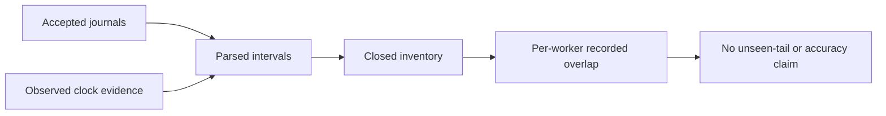

# Recorded timer wait overlap

`AnalyzeTimerWaitMembership.py` parses reconciled prefixes and observed clock evidence into immutable `ObservedTimerWaits`.
`Child` retains the accepted handler start and finish, in addition to wait and first capture.
The native `TimerApi.Linux.cpp` backend measures `after - before` inside the handler interval.
Exact wait placement is not serialized, but containment permits conservative overlap limits.

For handler duration `D`, recorded wait `W`, guaranteed overlap `G`, and possible overlap `P`, the limits are:

```python
lower = max(0, W - (D - G))
upper = min(W, P)
```

The window core is `[start.after, end.before)`. Its envelope is `[start.before, end.after)`.
Worker totals sum child limits separately. They never sum both workers into global delay.
Final closure and complete archival are required. Unknown inventory cannot become a zero suffix.
Cross-generation handlers must not overlap within one slot.
Frozen accounting cannot include a native capture timestamp after its upper endpoint reading.

The clock policy is conditional on the current Linux monotonic backend and observed sample clock assumptions.
Declarations are not binary attestation. These ranges do not establish physical accuracy or unseen native-tail bounds.
Frozen accepted wait remains a separate value. Later acceptance does not imply later execution.
Failed workload evidence remains intact. Matched prediction eligibility is unchanged.

The small-domain exhaustive check enumerates possible wait placements and endpoint choices.
It verifies that the reported range contains every resulting overlap.
Focused checks cover exact inside and outside waits, boundary ambiguity, late acceptance, invalid prefixes, unknown closure, and cross-generation overlap.
The [retained capture analysis](../../reliability/features/native-signal/timer-wait-membership.md) places all recorded positive waits inside the guaranteed window.
The treatment still fails the unchanged debt gate. No timing case was repeated.



See [timer accounting](timer-accounting.md), [sample membership](sample-membership.md), and [the reference](../../docsSrc/Reference/timer-wait-membership.md).
