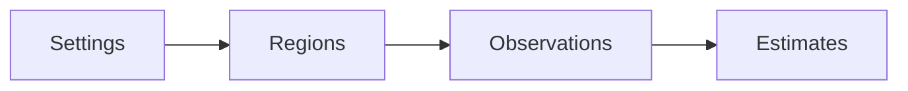

# Project scope

CozNet is an experimental F# library for .NET 10. The public engine compares proportional delays in serial CPU regions. It records randomized blocks and paired elapsed-time reductions. An internal immutable ledger models sampled Coz delay credits, thread lifecycle, and dependency wakes. An internal cooperative adapter performs measured waits from this ledger. It is not connected to the native sampler. The public API requires explicit regions and progress. Parallel, async, native sampling, and general application accuracy remain unsupported. The repository uses MiniScaffold as its basis and `master` as its default branch. The checksum sample compares predictions with actual reductions in work.

```fsharp
session.Region(region, fun () -> cpuWork ())
session.Progress()
```



A separate Windows x64 [CLR probe prototype](profiling/runtime-probes.md) verifies selective IL rewriting in a controlled loop.
An internal [cooperative runtime](profiling/cooperative-runtime.md) connects the ledger to measured managed waits and cancellation recovery.
It also verifies asynchronous stack snapshots through a Windows backend behind a shared sampler interface.
It does not extend the public engine's supported workload model.

See [engine contracts](profiling/summary.md), [sampled accounting](profiling/delay-ledger.md), [practices](practices.md), and [future work](plans/roadmap.md).
