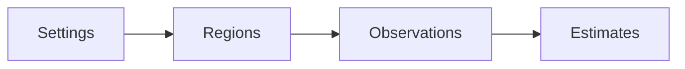

# Project scope

CozNet is an experimental F# library for .NET 10. The engine compares proportional delays in serial CPU regions. It records randomized blocks and paired elapsed-time reductions. The public API requires explicit regions and progress. Parallel, async, native sampling, and general application accuracy remain unsupported. The repository uses MiniScaffold as its basis and `master` as its default branch. Deterministic tests cover accounting and lifecycle. The checksum sample compares predictions with actual reductions in work.

```fsharp
session.Region(region, fun () -> cpuWork ())
session.Progress()
```



See [engine contracts](profiling/summary.md), [practices](practices.md), and [future work](plans/roadmap.md).
