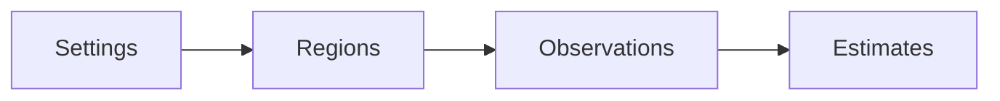

# Project scope

The callback-reuse comparison completes but retains a 9.9977–10.0364 percentage-point prediction shortfall.
All recorded treatment credit is source-inside. Allocation reuse does not resolve instrumentation attribution or extra treatment CPU.
The timer workload implements opt-in [nominal-event credit](plans/timer-nominal-credit.md) without IL loop probes.
Its declared capture verifies preparation, live reset, and both accounting replays but retains a 2,361,731 ns treatment peer-debt failure.
The receipt audit identifies delayed same-epoch credit publication. A separate scheduler diagnostic measures 13.800756 ms controller preemption during a receipt gap.
The portable [native sample decoder](plans/target-local-samples.md) accepts one validated 48-byte or 56-byte perf record per call and preserves terminal failures.
A Linux x64 ring adapter reads a live task-clock mapping and requires `PERF_FORMAT_LOST`. Its live overflow case detects loss only through the final 16-byte read.
[Target-local dispatch](plans/target-local-dispatch.md) requests a signal to the sampled thread for each overflow. The kernel merges overflows before its deferred wakeup work. Each dispatch drains under record and elapsed budgets.
Its live modes cover backlog, terminal loss, cancellation, and retirement.
The [native ledger](plans/target-local-credit.md) credits and pays on each thread with a valid sequence replay in a two-thread native run.
A [CLR fork/join workload](plans/target-local-prediction.md) runs this path in managed threads through `TargetLocalProfiler.runBound` and replays every journal in F#.
Its passing qualifications predict real 50% optimizations in three configurations, with median absolute differences from about 1 to 3 percentage points. The latest run passes all three configurations. An earlier run failed the setup limit by one 0.60 ms stall, whose cause the retained records do not establish.
Explicit [barrier waits](plans/target-local-status.md#wait-protocol) follow the Coz wake rule, with a skip bounded by the release token. Their latest two qualifications pass all criteria. Each worker now sets its thread state before sampling starts, which cuts the median setup segment from 0.70 ms to 0.0049 ms. Earlier failures correlate with run-queue delay and possible SMT contention, and one followed a diagnostic read in the timed window that raised overhead. One predates the diagnostics. A captured debt failure follows an 8.7 ms delay between a release and the wake, which is close to that thread's whole-run run-queue delay.
[Code binding](plans/target-local-lifecycle.md) rejects tiered code and moved ranges, and shutdown during payment exits cleanly.
The qualified model excludes other blocking, async, and GC-heavy work. The profile-zero handler share is about 0.1% of elapsed time. A [forced-GC check](plans/target-local-transitions.md) passes 10 of 10 in sixteen checks, including the latest, and fails 1 of 10 in five others, each by the 2 ms debt bound. In the latest failure, the GC windows cover only 0.22 ms of the 5.75 ms failure interval. A ReJIT check shows that a ReJIT of a bound method fails the run. A cleanup check shows that a failed monitor still closes the experiment.
An earlier check with a flawed count failed the debt bound in 1 of 10.
See [the evidence](../reliability/features/target-local/transitions.md). That failure's cause needs GC suspension timestamps. The runner does not record kernel identity.
General CLR safety remains unverified.

Optional clock capture now binds both sampled arms to the [matched comparison plan](profiling/sample-membership.md#matched-comparison-activation).
The retained 500,000-batch block places all recorded treatment credit inside the observed source window and frozen prefix.
Its sampled reduction is 33.28–33.32%, versus 46.04% physically. Treatment consumes 324.9 ms more selected-thread CPU.
Recurring execution cost and inline instrumentation attribution remain unresolved. Pending ownership and ledger residuals still prevent qualification.

Optional [selected-thread CPU capture](plans/selected-cpu.md) binds readings in all four comparison arms through a portable clock hook.
The Linux block completes with sampled zero at 221.9 ms CPU and sampled half at 277.0 ms CPU.
Each sampled CPU bracket differs from elapsed time by less than 0.025 ms.
The prediction remains about 30 percentage points below physical reduction. Recurring observer CPU is the next component investigation.

The optional [nominal-event estimator](profiling/nominal-event-credit.md) credits initial and resumed selected events under native Coz's inspected event rule.
Its Linux diagnostic passes zero, treatment, and expected invalidation cases with full replay.
Its four-arm comparison completes but estimates a 0.9–1.3% slowdown against about 53.9% physical elapsed reduction.
It remains opt-in and unqualified. Observer cost, attribution, and finite boundary membership remain accuracy issues.

Cooperative physical and finite sampled work now [prepare measurement capture](profiling/measurement-boundaries.md) before the real start.
Preparation has separate boundaries and permanent failure state. It does not supply estimator inputs.
The [final prepared comparison](../reliability/features/native-signal/measurement-preparation.md) completes four arms but remains unqualified.
Its descriptive sampled reduction is about 8.7%, versus about 51.3% physically. Smaller boundary brackets do not resolve that mismatch.
Profiler overhead and sampled attribution remain the next accuracy issues.


An explicit [native owner/controller mode](profiling/cooperative-interop.md) reserves one slot for the session creator.
Default role separation remains. Native checks pass on Windows and Linux.
The [managed integration](../docsSrc/Reference/owner-controller.md) passes twenty controlled CLR cases on Windows and Linux.
The first Linux sampled diagnostic passes zero-speedup, 50-percent, and expected-invalidation checks with a separate peer.
The [matched comparison](../reliability/features/native-signal/owner-controller-comparison.md) passes all twelve expected checks across four groups.
Owner groups have shorter observed selected receipt and callback intervals, but elapsed variation prevents a general savings claim.
Measurements remain unqualified. The mode remains opt-in.

An opt-in [finite cooperative capture](profiling/cooperative-measurement.md) freezes global delay and progress before cleanup.
It preserves invalid outcomes and unqualified native ownership.
The [first matched cooperative block](profiling/cooperative-physical.md) completes all four arms but remains unqualified.
Its descriptive virtual and physical reductions differ.
The [phase capture](../docsSrc/Explanations/cooperative-pause-cost.md) places 26.240063 ms of 39.796340 ms in publication through callback return.
Controller round trips require investigation. The retained dispatch tail cannot establish total dispatch cost.
Its first Linux capture freezes a pending peer request before cleanup settlement. Both completed measurements remain unqualified.

An opt-in [selected scheduling handoff](profiling/selected-handoff.md) preserves debt accounting and attempts one yield at a qualifying selected checkpoint.
Its first CPU 0 treatment fails the handler bound while its control passes.
The policy remains disabled by default. It does not establish a capacity or prediction fix.

Opt-in [bound scheduler capture](profiling/bound-scheduler.md) now correlates peer progress with three owner-bound scheduler streams.
One constrained treatment fails peer debt while its request-to-debt window lies inside an observed peer switch-out interval.
Clock assumptions remain explicit. Accounting limits remain unchanged, and stable capacity is unverified.

An opt-in [native progress marker](profiling/cooperative-progress-marker.md) now captures peer submission and failed-debt observations.
Its unrestricted treatment fails the receipt limit. A one-CPU run captures pending markers after two failed debt gates.
The markers do not establish why the peer did not reach a native poll.

The [peer-progress analyzer](profiling/peer-progress.md) places one direct trial's first child after its debt observation under explicit clock-rate assumptions.
A later retired journal does not establish payment before the gate. Peer scheduling remains unresolved.

An opt-in [receipt-readiness query](profiling/receipt-readiness.md) replaces normal controller header polling with atomic observation.
Full receipt validation and cleanup retain controller ownership. Capacity and overhead benefits remain unverified.
Its two one-CPU treatments fail peer debt earlier than the interleaved controller trials. Controller polling remains the default.

An opt-in [dispatch diagnostic](profiling/controller-dispatch.md) retains controller queue, action, and return brackets without changing payment rules.
Its one-CPU failure separates a short failed receipt-read action from a 115.427269 ms caller-observation interval. The cause of that interval remains unresolved.

An opt-in [batch service comparison](profiling/sample-publication.md) changes peer service cadence while preserving every per-sample debt gate.
Both batch treatments fail peer debt in the retained one-CPU comparison. Stable capacity and prediction remain unverified.

CozNet is an experimental F# library for .NET 10. The public engine compares proportional delays in serial CPU regions. It records randomized blocks and paired elapsed-time reductions. An internal immutable ledger models sampled Coz delay credits, thread lifecycle, and dependency wakes. An internal cooperative adapter performs measured waits from this ledger. A controlled Linux workload connects sampled method periods to this adapter. The public API requires explicit regions and progress. The public engine does not support parallel, async, or native sampling. General application accuracy remains unverified. The repository uses MiniScaffold as its basis and `master` as its default branch. The checksum sample compares predictions with actual reductions in work.

```fsharp
session.Region(region, fun () -> cpuWork ())
session.Progress()
```



A separate Windows and Linux x64 [CLR probe prototype](profiling/runtime-probes.md) verifies selective IL rewriting in a controlled loop.
An internal [cooperative runtime](profiling/cooperative-runtime.md) connects the ledger to measured managed waits and cancellation recovery.
The CLR prototype also verifies asynchronous stack snapshots through a Windows backend behind a shared sampler interface.
It does not extend the public engine's supported workload model.
A separate [Linux task-clock workload](profiling/linux-perf.md) verifies per-thread CPU events in a container with the required syscall access.
Those events resolve against a fixed managed method map and drive credits at manual or injected probes in a controlled two-thread workload.
Dense injected probes have excessive cost. Countdown probes reduce that cost in the controlled Linux comparison.
Inline countdown instructions remain inside selected-method CPU attribution. Exact profiler-CPU exclusion remains unresolved.
An optional raw-map sensitivity diagnostic excludes injected IL candidates. Both diagnostic modes still fail the physical-prediction gate.
See [the retained comparison](../reliability/features/linux-perf/attribution-sensitivity.md).
The [component comparison](../reliability/features/linux-perf/component-overhead.md) identifies injected probes as the largest measured overhead stage in the tiny loop.
A separate [signal experiment](profiling/signal-intervention.md) passes bounded arithmetic and forced-GC cases on Linux x64.
General CLR safety and sampled signal-driven prediction remain unverified.
A separate [scheduler probe](profiling/scheduler-records.md) captures per-thread switch records on the current Linux kernel.
Its overflow case requires the final loss counter to detect missing records.
The optional scheduler route captures the controller and both targets with zero reported loss in four Linux cases.
The GC treatment still fails the debt limit. Its delayed requests overlap observed target switch-out intervals.
Blocking cause, observer cost, and prediction accuracy remain unresolved.
The [combined scheduler and runtime trace](../reliability/features/native-signal/scheduler-runtime.md) preserves a forced-GC capacity failure with valid correlation.
A long peer request has no enclosing runtime suspension overlap.
The retained product maps to runtime sources where restart releases barriers without waiting for each worker to execute.
Neither restart nor observed off-CPU time justifies debt forgiveness.
An internal [signal accounting model](profiling/signal-accounting.md) connects sample credit to bounded requests and matched acknowledgments.
An internal [peer service model](profiling/signal-service.md) adds finite leases and exact-once aggregate settlement of bounded child journals.
Its [portable native owner](profiling/native-service-owner.md) passes fake-transport checks on Windows and Linux.
Its [Linux transport](profiling/linux-service-transport.md) passes controlled native delivery and lifetime checks.
Its [C ABI and managed client](profiling/service-interop.md) pass controlled receipt and lifetime checks.
Its [ledger adapter](profiling/service-accounting-adapter.md) passes pure and controlled live journal checks.
Its sampled native service path now runs through both adapters. The first zero-speedup case passes, but treatment fails during warmup at 19,999,953 ns of peer debt. See [the retained service run](../reliability/features/native-signal/sampled-service/README.md).
Its deterministic replay checks cover debt settlement and sampling epochs.
The [live sampled signal workload](profiling/sampled-signals.md) connects these components, but its first run fails the observed debt limit.
Sample-driven selected checks recover credit. The first warmup run then fails the handler-duration bound.
The native phase comparison passes two of three 50-percent capacity cases and all protocol checks.
Wait overshoot and service stability remain unresolved.
The [service timing records](../reliability/features/native-signal/service-timing.md) expose long pending requests that perform no native wait.
The [native phase records](../reliability/features/native-signal/phase-timing.md) place most of one long request before the first handler clock reading.
The [allocation comparison](../reliability/features/native-signal/gc-and-ring-cache.md) removes empty-drain allocation but still exposes gigabytes of controller allocation and a capacity failure.
The [peer cadence](../reliability/features/native-signal/peer-cadence.md) skips redundant accounting preparation and reduces allocation in completed cases.
Its retained run still fails handler or debt limits in every 50-percent case.
The [direct accounting read](../reliability/features/native-signal/accounting-read.md) removes a wrapper allocation from the full controller's generated code.
Zero-percent allocation falls to about 5.17 MiB. Two treatment cases still exceed the handler limit during native waits.
The [wait comparison](../reliability/features/native-signal/wait-comparison.md) passes three sampled spin treatments but fails all three sleep treatments.
Spin increases measured process CPU.
The [spin reliability run](../reliability/features/native-signal/spin-reliability.md) passes all runtime transitions and sampled protocol checks.
Two forced-GC treatments fail capacity. Physical-change prediction remains unverified.
An explicit [diagnostic trace path](profiling/runtime-suspension-trace.md) records bracketed EventPipe clock markers.
An explicit abort marker permits correlation of recorded failed runs while preserving workload failure.
Deterministic warmup and measurement failure fixtures pass through Linux EventPipe and on Windows.
Its first local capture has consistent clock alignment and zero reported event loss.
The correlation finds 104 complete suspension episodes and 53 overlapping measurement requests. It does not explain the earlier capacity failures.
The subsequent traced comparison retains four failed treatments. A long acknowledgment-observation delay has no runtime suspension overlap.
Controller work and scheduling remain unresolved. One handler-bound failure has an incomplete marker sequence and fails correlation validity.
A [controller CPU diagnostic](../reliability/features/native-signal/controller-cpu.md) retains two capacity failures in twelve cases.
One peak-debt request spends 12.97 ms before the first handler clock reading while the controller remains active.
Target scheduling, signal delivery, and handler-prefix execution or descheduling remain unresolved. Controller starvation does not explain that request.
General eligibility, source-line mapping, and prediction accuracy remain unverified.
An optional [target CPU diagnostic](profiling/target-cpu-observations.md) captures remote CPU readings around requests without changing the handler.
Its native contract checks pass. The first capture retains two treatment failures and five inconsistent target CPU records.
Clock accuracy, diagnostic overhead, and target execution bounds remain unverified.

See [engine contracts](profiling/summary.md), [sampled accounting](profiling/delay-ledger.md), [practices](practices.md), and [future work](plans/roadmap.md).


The native cooperative transport has an optional [child CPU journal](profiling/cooperative-interop.md#optional-cpu-records).
Linux records owner-thread CPU readings around admitted wait attempts. Other platforms report unsupported capability.
The separate diagnostic snapshot preserves failed children and requires mailbox quiescence.
Managed capture and selected-payment replay retain these records, including failed service evidence.
CPU observations do not replace wall-time payment.

The [single-CPU cooperative diagnostic](../reliability/features/native-signal/cooperative-single-cpu.md) retains a peer debt failure after 8538 selected batches.
Its late credits come from buffered samples, and the pending peer request has no child in its first failure snapshot.
No handler exceeds 5 ms. An opt-in owner-driven collector now drains before selected debt checks. Its first ordinary-CPU-set run passes all three cases, while the background treatment fails selected debt. Stable capacity and isolated overhead remain unverified.

The [one-CPU owner/background comparison](../reliability/features/native-signal/owner-drain-single-cpu.md) fails all four treatments with verified evidence.
One owner failure accrues new credit after peer arming. Another rejects a managed receipt interval without retaining its exact endpoint.
Owner draining does not establish stable service capacity.

The bound sampled workload retains rejected managed receipt interval arguments and request identity.
Controlled Windows/Linux checks cover both slots. The first new constrained capture fails peer debt before exercising live receipt rejection.
