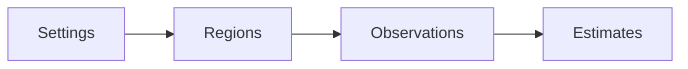

# Project scope

CozNet is an experimental F# library for .NET 10. The public engine compares proportional delays in serial CPU regions. It records randomized blocks and paired elapsed-time reductions. An internal immutable ledger models sampled Coz delay credits, thread lifecycle, and dependency wakes. An internal cooperative adapter performs measured waits from this ledger. A controlled Linux workload connects sampled method periods to this adapter. The public API requires explicit regions and progress. The public engine does not support parallel, async, or native sampling. General application accuracy remains unverified. The repository uses MiniScaffold as its basis and `master` as its default branch. The checksum sample compares predictions with actual reductions in work.

```fsharp
session.Region(region, fun () -> cpuWork ())
session.Progress()
```



A separate Windows and Linux x64 [CLR probe prototype](profiling/runtime-probes.md) verifies selective IL rewriting in a controlled loop.
An internal [cooperative runtime](profiling/cooperative-runtime.md) connects the ledger to measured managed waits and cancellation recovery.
The CLR prototype also verifies asynchronous stack snapshots through a Windows backend behind a shared sampler interface.
It does not extend the public engine's supported workload model.
A separate [Linux task-clock workload](profiling/linux-perf.md) verifies per-thread CPU events in a container with the required syscall access.
Those events resolve against a fixed managed method map and drive credits at manual or injected probes in a controlled two-thread workload.
Dense injected probes have excessive cost. Countdown probes reduce that cost in the controlled Linux comparison.
Inline countdown instructions remain inside selected-method CPU attribution. Exact profiler-CPU exclusion remains unresolved.
An optional raw-map sensitivity diagnostic excludes injected IL candidates. Both diagnostic modes still fail the physical-prediction gate.
See [the retained comparison](../reliability/features/linux-perf/attribution-sensitivity.md).
The [component comparison](../reliability/features/linux-perf/component-overhead.md) identifies injected probes as the largest measured overhead stage in the tiny loop.
A separate [signal experiment](profiling/signal-intervention.md) passes bounded arithmetic and forced-GC cases on Linux x64.
General CLR safety and sampled signal-driven prediction remain unverified.
A separate [scheduler probe](profiling/scheduler-records.md) captures per-thread switch records on the current Linux kernel.
Its overflow case requires the final loss counter to detect missing records.
The optional scheduler route captures the controller and both targets with zero reported loss in four Linux cases.
The GC treatment still fails the debt limit. Its delayed requests overlap observed target switch-out intervals.
Blocking cause, observer cost, and prediction accuracy remain unresolved.
The [combined scheduler and runtime trace](../reliability/features/native-signal/scheduler-runtime.md) preserves a forced-GC capacity failure with valid correlation.
A long peer request has no enclosing runtime suspension overlap.
The retained product maps to runtime sources where restart releases barriers without waiting for each worker to execute.
Neither restart nor observed off-CPU time justifies debt forgiveness.
An internal [signal accounting model](profiling/signal-accounting.md) connects sample credit to bounded requests and matched acknowledgments.
An internal [peer service model](profiling/signal-service.md) adds finite leases and exact-once aggregate settlement of bounded child journals.
Its native transport and workload integration remain unimplemented.
Its deterministic replay checks cover debt settlement and sampling epochs.
The [live sampled signal workload](profiling/sampled-signals.md) connects these components, but its first run fails the observed debt limit.
Sample-driven selected checks recover credit. The first warmup run then fails the handler-duration bound.
The native phase comparison passes two of three 50-percent capacity cases and all protocol checks.
Wait overshoot and service stability remain unresolved.
The [service timing records](../reliability/features/native-signal/service-timing.md) expose long pending requests that perform no native wait.
The [native phase records](../reliability/features/native-signal/phase-timing.md) place most of one long request before the first handler clock reading.
The [allocation comparison](../reliability/features/native-signal/gc-and-ring-cache.md) removes empty-drain allocation but still exposes gigabytes of controller allocation and a capacity failure.
The [peer cadence](../reliability/features/native-signal/peer-cadence.md) skips redundant accounting preparation and reduces allocation in completed cases.
Its retained run still fails handler or debt limits in every 50-percent case.
The [direct accounting read](../reliability/features/native-signal/accounting-read.md) removes a wrapper allocation from the full controller's generated code.
Zero-percent allocation falls to about 5.17 MiB. Two treatment cases still exceed the handler limit during native waits.
The [wait comparison](../reliability/features/native-signal/wait-comparison.md) passes three sampled spin treatments but fails all three sleep treatments.
Spin increases measured process CPU.
The [spin reliability run](../reliability/features/native-signal/spin-reliability.md) passes all runtime transitions and sampled protocol checks.
Two forced-GC treatments fail capacity. Physical-change prediction remains unverified.
An explicit [diagnostic trace path](profiling/runtime-suspension-trace.md) records bracketed EventPipe clock markers.
An explicit abort marker permits correlation of recorded failed runs while preserving workload failure.
Deterministic warmup and measurement failure fixtures pass through Linux EventPipe and on Windows.
Its first local capture has consistent clock alignment and zero reported event loss.
The correlation finds 104 complete suspension episodes and 53 overlapping measurement requests. It does not explain the earlier capacity failures.
The subsequent traced comparison retains four failed treatments. A long acknowledgment-observation delay has no runtime suspension overlap.
Controller work and scheduling remain unresolved. One handler-bound failure has an incomplete marker sequence and fails correlation validity.
A [controller CPU diagnostic](../reliability/features/native-signal/controller-cpu.md) retains two capacity failures in twelve cases.
One peak-debt request spends 12.97 ms before the first handler clock reading while the controller remains active.
Target scheduling, signal delivery, and handler-prefix execution or descheduling remain unresolved. Controller starvation does not explain that request.
General eligibility, source-line mapping, and prediction accuracy remain unverified.
An optional [target CPU diagnostic](profiling/target-cpu-observations.md) captures remote CPU readings around requests without changing the handler.
Its native contract checks pass. The first capture retains two treatment failures and five inconsistent target CPU records.
Clock accuracy, diagnostic overhead, and target execution bounds remain unverified.

See [engine contracts](profiling/summary.md), [sampled accounting](profiling/delay-ledger.md), [practices](practices.md), and [future work](plans/roadmap.md).
