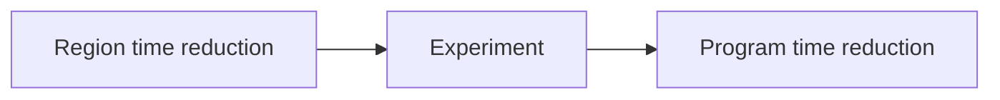

# Profiling terms

The canonical domain definitions are in [terminology.md](../terminology.md).
Use those definitions in code, reports, and future plans.

- Lode - Persistent project knowledge under `lode/`.
- Serial engine - The current experiment implementation with one owning thread.
- Measurement validity - Evidence that the intervention predicts a real optimization.

```fsharp
VirtualSpeedup.tryCreate 0.5
```

This value requests a 50% reduction in region execution time, not a 50% throughput increase.



See [engine contracts](profiling/summary.md) and [the index](lode-map.md).
